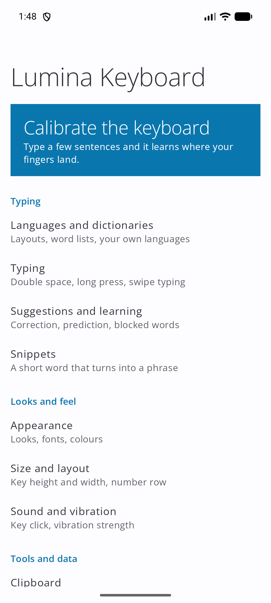
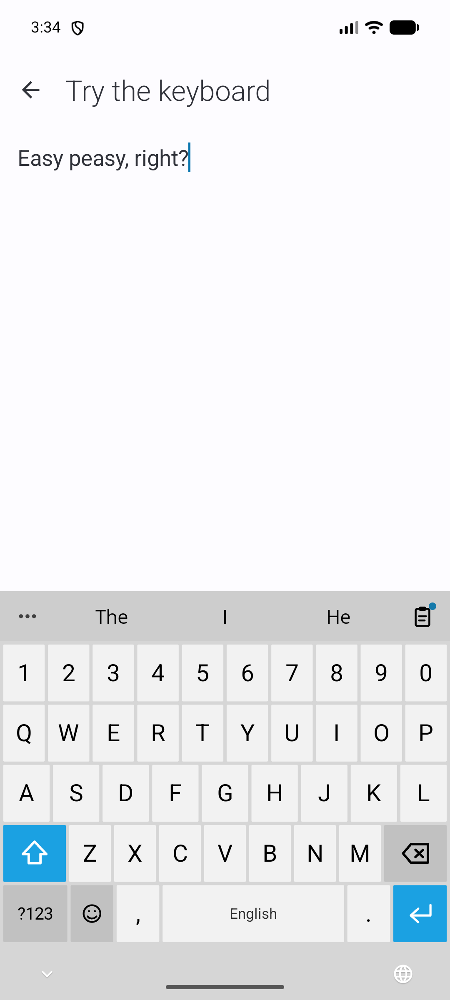
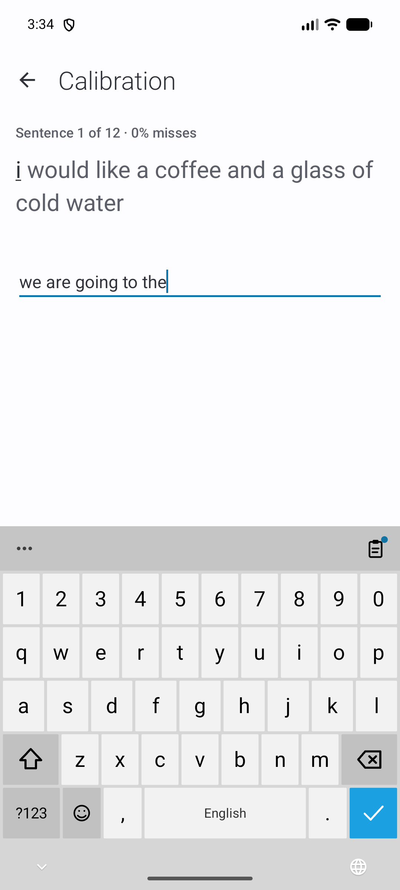

<h1 align="center">MetroWin Keyboard</h1>

<p align="center">
  <b>The Windows Phone keyboard, on Android.</b><br>
  Flat Metro keys, big light type, swipe typing, clipboard history, voice typing.<br>
  Free software. No ads, no analytics, no trackers: what you type stays on your phone.
</p>

<p align="center">
  <a href="LICENSE"></a>
  <a href="https://github.com/developerkenshi-coder/MetroWin-Keyboard/releases/latest"></a>
  
  <a href="https://github.com/developerkenshi-coder/MetroWin-Keyboard/releases"></a>
  
</p>

<p align="center"><b>English</b> · <a href="README.it.md">Italiano</a></p>

<p align="center"></p>

<p align="center">
  
  
  
  
  
</p>

Made to work together with [MetroWin Launcher](https://github.com/developerkenshi-coder/MetroWinLauncher): same three looks, same 20 colours, and it keeps out of the way in the launcher's search box. It works fine with any other launcher too.

> **Looking for the matching launcher?** MetroWin Keyboard is made to live next to **[MetroWin Launcher](https://github.com/developerkenshi-coder/MetroWinLauncher)**, a free, open source Windows Phone style home screen for Android: live tiles, the pivot settings, the same colours. Install both and your phone looks and types like one system.

## Install

1. Download the APK from the [latest release](../../releases/latest) and open it (allow your browser or file manager to install unknown apps).
2. Open **MetroWin Keyboard**. A guided set-up turns the keyboard on and selects it, noticing by itself when each step is done.
3. A tutorial is in the app and inside the keyboard (the three dots, then **?**).

Android 8.0 (API 26) or newer.

## Features

**Typing**
- Swipe typing, hold a key for accents, digits and symbols (hold time in ms, 200 by default), double space for a full stop, automatic capitals, slide on the space bar to move the cursor.
- A colour preview of the key you press, as on Windows Phone.
- Correction that **Backspace undoes** and learns from (smart: it weighs where your finger landed, the words around it and what you undid before; it offers a missing space), accent fixing, completion, next-word and phrase prediction, offensive words blocked (plus your own list).
- Learns from you, **on the phone only**; never in password fields; exportable and erasable.

**Tools**, one tap from the bar: the three dots open the toolbox, and a **quick button** goes straight to the clipboard (or any tool you choose), with a dot when something new was copied.
- **Clipboard** history with a limit you choose, pinned items and **pictures**.
- **Emoji** and **classic emoticons** (`:-)`, kaomoji), with skin tones.
- **Voice typing**, also continuous transcription, optionally on-device only.

**Calibration**: no other keyboard does this. Type a few sentences and the keyboard learns where *your* fingers land (the offset, the curve of your thumb, how far your taps spread), corrects your touches without moving the keys, makes them taller or the gaps smaller if you still miss, and puts each fix to work between one sentence and the next so you see it improve. Accented letters are part of the test. Nothing is kept until you apply it.

**Smart correction**: a small model that runs on the phone fixes typos from where your finger landed, how likely each slip is on the keyboard, how common the word is, the word before it and the corrections you undid. Two equally likely fixes are shown, not applied. A missing space is offered.

**Backup**: one file with everything the app keeps (settings, learned words, dictionaries, clipboard); restore it on another phone or after reinstalling with another signature.

**Languages**: 17 layouts included (English, Italiano, Español, Français, Deutsch, Português, Nederlands, Polski, Türkçe, Русский, Українська, Ελληνικά, Čeština, Svenska, Română, العربية, עברית). Any other layout is a small text file ([docs/LAYOUTS.md](docs/LAYOUTS.md)); any dictionary can be imported (word lists, frequency lists, Hunspell `.dic`). Only small starter word lists are bundled (en, it, es, fr, de, pt), so import a full dictionary for the best predictions.

**Looks**: *Classic* (flat Windows Phone), *Modern Glass*, *Modern Droid* (Material You colours on Android 12+), dark / light / system, 20 Windows Phone colours or your own, pure black, a photo behind the keys (its colour becomes the accent), and, optionally, a keyboard that follows the colour of the app under it.

**Size**: a live preview, key height (portrait and landscape), keyboard width with left / centre / right position, key spacing, number row on or off, and an automatic calibration that learns from a few typed sentences where your fingers land.

**Feedback**: a Windows Phone style click (synthesised, nothing of Microsoft's inside), Android's sound or your own file; vibration with adjustable strength.

## Privacy and permissions

No analytics, ads or trackers. The full list is in [PRIVACY.md](PRIVACY.md).

| Permission | Why |
| --- | --- |
| `RECORD_AUDIO` | Voice typing only; asked when you tap the microphone |
| `INTERNET` | Only for the update check, which asks this keyboard's own repository on GitHub every 12 hours (can be switched off) |
| `REQUEST_INSTALL_PACKAGES` | Only to open the installer on a new version you chose to download in *Settings → Updates* |
| `RECEIVE_BOOT_COMPLETED` | Keeps the 12-hour update check after a restart |
| `VIBRATE` | Key vibration |

Backups and device transfer are disabled for the app's data. The colour service is off until you turn it on in the accessibility settings, reads no text and sends nothing.

## MetroWin Launcher

[**MetroWin Launcher**](https://github.com/developerkenshi-coder/MetroWinLauncher) is the other half of this project: a free and open source launcher that brings the Windows Phone Start screen, pivot settings and live tiles to Android. The keyboard recognises it, imports its theme file and follows its look and colours; see [docs/LAUNCHER_INTEGRATION.md](docs/LAUNCHER_INTEGRATION.md). It is also listed inside the app, under *About → Other projects*.

## Other projects

| | Project | |
| --- | --- | --- |
| Open source | [MetroWin Keyboard](https://github.com/developerkenshi-coder/MetroWin-Keyboard) | this keyboard |
| Open source | [MetroWin Launcher](https://github.com/developerkenshi-coder/MetroWinLauncher) | the Windows Phone style launcher |
| Not open source | [SpesaTracker](https://play.google.com/store/apps/details?id=com.spesatracker.app) | on Google Play |

## Build from source

JDK 17 or newer and the Android SDK (platform 35).

```sh
git clone https://github.com/developerkenshi-coder/MetroWin-Keyboard.git
cd MetroWin-Keyboard
./gradlew assembleDebug          # app/build/outputs/apk/debug/app-debug.apk
./gradlew testDebugUnitTest      # engine, keyboard and tutorial tests on the JVM
./gradlew assembleRelease        # needs keystore.properties (see app/build.gradle.kts); -PsignWithDebugKey=true for a test build
```

## Contributing

Bug reports and ideas are welcome in the issue tracker, in English or Italian. See [CONTRIBUTING.md](CONTRIBUTING.md), which includes the checklist for adding a feature (and its tutorial page). Security issues: [SECURITY.md](SECURITY.md).

## License and credits

GNU General Public License v3.0 or later ([LICENSE](LICENSE)). Fonts are Open Sans (SIL Open Font License 1.1); see [THIRD_PARTY_NOTICES.md](THIRD_PARTY_NOTICES.md).

MetroWin Keyboard is an independent project. It is not affiliated with or endorsed by Microsoft or Google; Windows Phone is a trademark of Microsoft Corporation.
